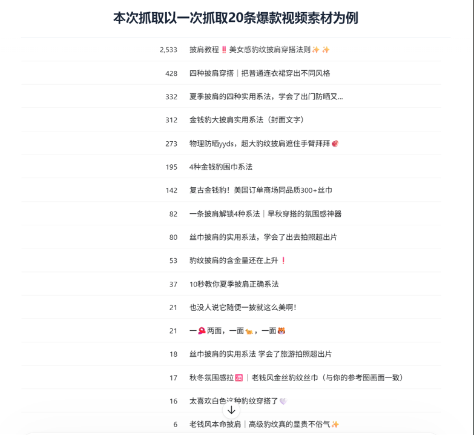
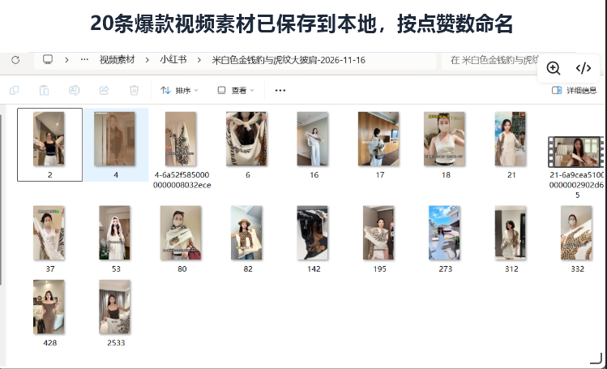
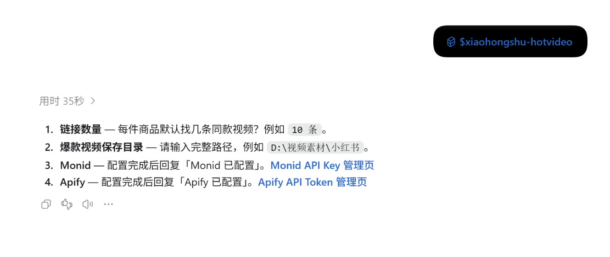

# 用Codex实现批量抓取小红书爆款商品素材

上传一张商品图，Codex 会在小红书上找同款视频，按搜索时的点赞数排序，并把核实后能下载的视频存到电脑里。你可以设置每次想找多少条，以及视频保存到哪里。

电商人还在花几小时手动扒爆款素材？为了解决这个痛点，我自己写了一个 Codex Skill：**实测约 10 分钟，把 20 条小红书同款高赞视频去水印下载到本地。**

给它一张产品图，它就会按点赞数筛选小红书上的同款带货视频。能找到多少条取决于平台存量和同款筛选结果，下载数量可以自行设置。

### 效果展示

### 💰 成本测算

- 按本次用量估算，抓取和下载 **20 条视频约花费 ¥2**。
- 按文章发布时的免费额度估算，新注册 Monid 和 Apify 账号大约可以处理 **50–100 条**；实际数量取决于账号额度和搜索、下载用量。

### 🛠️ 三步配置教程

#### 1. 安装依赖

把下面的指令发给 Codex 或 Claude Code：

- 安装 Skill：`https://github.com/kyy338/xiaohongshu-hotvideo`
- 配置 Monid：`set up https://monid.ai/SKILL.md`
- 配置 Apify：`https://mcp.apify.com?tools=actors,agentflow/xiaohongshu-video-downloader`

#### 2. 初始化设置

调用 `$xiaohongshu-hotvideo`，按提示设置每次下载的数量、视频保存目录，并完成 Monid 和 Apify 配置。详细步骤见[首次配置指南](references/first-run.md)。

#### 3. 上传图片开始搜索

上传一张产品图并调用 `$xiaohongshu-hotvideo`。Skill 会筛选同款高赞视频，并把符合条件、可下载的视频保存到指定目录。

### skill单轮运行架构流程图

如果这个 Skill 对你有帮助，麻烦点个 Star 支持一下吧。

